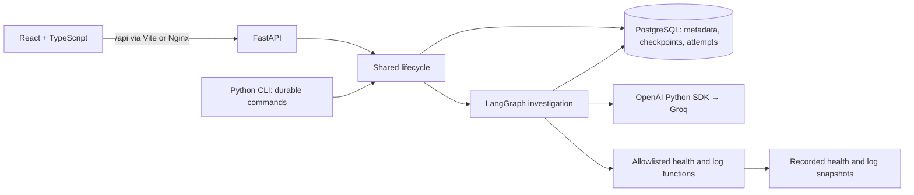

# IncidentClue

IncidentClue is an AI-powered incident investigation tool that turns recorded
logs and service health into evidence-linked hypotheses and clear next steps.
Investigations can be paused, reopened and resumed across restarts, with evidence
and progress saved.

## Contents

- [Technology choices](#technology-choices)
- [Implemented capabilities](#implemented-capabilities)
- [Architecture](#architecture)
- [Quick start](#quick-start)
- [Documentation](#documentation)

## Technology choices

| Technology | Purpose |
| --- | --- |
| Python + Pydantic | Backend logic and data validation |
| FastAPI + Uvicorn | REST API |
| React + TypeScript + Vite | Browser interface |
| LangGraph | Bounded investigation workflow |
| Groq + OpenAI Python SDK | Direct model calls |
| PostgreSQL + PostgresSaver | Saved state, checkpoints and recovery |
| Docker Compose + Nginx | One-command startup and API proxy |

## Implemented capabilities

- **Evidence-linked diagnosis:** Structured hypotheses with evidence references,
  missing information and diagnostic checks, validated through Pydantic and
  application rules.
- **Controlled AI execution:** LangGraph coordinates investigation within enforced
  limits of three model requests and two read-only tool attempts.
- **Durable recovery:** PostgreSQL checkpoints preserve investigation progress.
  Saved outputs are reused after interruption; uncertain attempts block replay
  to protect budgets.
- **Unified investigation lifecycle:** Create, inspect, pause and resume the same
  investigation through the browser, REST API or developer CLI.
- **Tested failure handling:** Real PostgreSQL crash and concurrency tests,
  browser tests and package/container CI, using fake providers for routine checks.

## Architecture

Use the React browser interface, FastAPI REST API or Python CLI. All three use the
same investigation engine and durable PostgreSQL lifecycle.



Resume runs until completion, pause or failure. Explore the
[workflow and recovery design](docs/workflow.md).

## Quick start

Requires Docker Desktop/Engine with Compose v2.

1. Copy [.env.example](.env.example) to `.env` in the repository root and set
   `GROQ_API_KEY`. If `.env` already exists, update it instead.
2. Start the complete application:

   ```sh
   docker compose --profile frontend up --build -d --wait frontend
   ```

3. Open [IncidentClue](http://localhost:8080) or [Swagger UI](http://localhost:8000/docs).

Docker handles the frontend, backend, database and storage setup. No separate
Python, Node.js or PostgreSQL installation is needed.

To stop while preserving saved investigations:

```sh
docker compose --profile frontend stop frontend web postgres
```

Avoid `docker compose down -v`, which deletes saved data.

## Documentation

| Guide | Contents |
| --- | --- |
| [Backend](backend/README.md) | Features, development and tests |
| [Frontend](frontend/README.md) | Features, development and tests |
| [HTTP API](docs/http-api.md) | Endpoints, Swagger UI and error codes |
| [Workflow and recovery](docs/workflow.md) | Investigation flow, storage and crash recovery |
| [Code map](docs/code-map.md) | Main source files and their responsibilities |
| [CLI guide](docs/cli.md) | Docker commands for saved and one-shot investigations |
| [Containerized RAG](docs/rag-container.md) | Optional v1 RAG image, model mount, separate vector database and offline restart verification |
| [RAG evaluation](docs/rag.md) | Retrieval contract, saved source citations and measured quality limitations |
| [Diagnosis pilot](docs/validation/pilot-2026-10-28.md) | Three synthetic cases, saved results and review findings |

### Testing and validation

The [CI workflow](.github/workflows/ci.yml) checks backend packages on Linux
(Python 3.12/3.13) and Windows (3.13), PostgreSQL recovery, containers and the
frontend.

For local test commands and environment setup, see the [backend](backend/README.md#tests-and-package-checks)
and [frontend](frontend/README.md#tests) guides.
