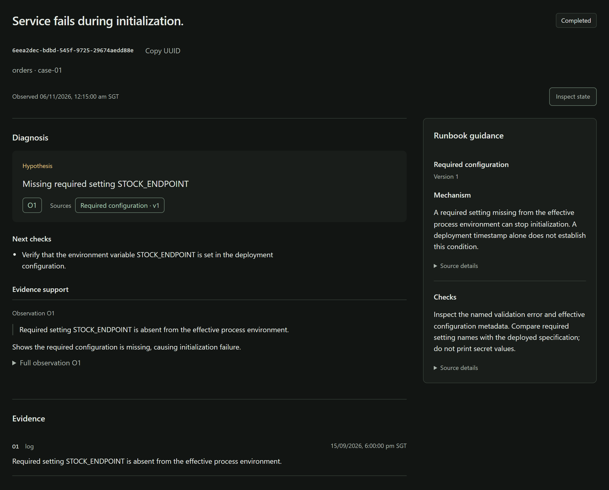
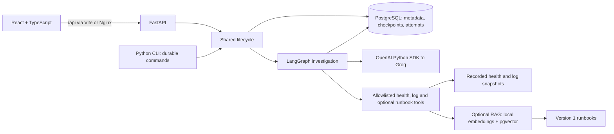

# IncidentClue

IncidentClue is an AI-powered incident investigation application built with
Python, FastAPI, LangGraph and React. It uses LLM tool calling, structured outputs
and optional Retrieval-Augmented Generation (RAG) to investigate recorded logs
and service health. PostgreSQL checkpointing preserves evidence and progress
across pauses and restarts.



## Contents

- [Technology choices](#technology-choices)
- [Implemented capabilities](#implemented-capabilities)
- [Architecture](#architecture)
- [Quick start](#quick-start)
- [Documentation](#documentation)

## Technology choices

| Technology | Purpose |
| --- | --- |
| Python + Pydantic | Backend logic, typed schemas and structured LLM output validation |
| FastAPI + Uvicorn | REST API |
| React + TypeScript + Vite | Browser interface |
| LangGraph | Stateful agent orchestration with bounded tool calling |
| Groq + OpenAI Python SDK | LLM inference, tool calling and structured output requests |
| PostgreSQL + PostgresSaver | Durable checkpointing, saved state and recovery |
| pgvector | Semantic vector search over runbook passages for RAG |
| FastEmbed + ONNX Runtime | Local CPU embeddings for runbooks and incident queries |
| Docker Compose + Nginx | One-command startup and API proxy |
| GitHub Actions + pytest + Playwright | Continuous integration, backend tests and browser end-to-end tests |

## Implemented capabilities

- **Structured LLM outputs:** Hypotheses with evidence references,
  missing information and diagnostic checks, validated through Pydantic and
  application rules.
- **LangGraph agent orchestration:** Model-selected tools run within enforced
  limits of three model requests and two read-only tool attempts.
- **Durable checkpointing and recovery:** PostgreSQL preserves investigation progress.
  Saved outputs are reused after interruption; uncertain attempts block replay
  to protect budgets.
- **Unified investigation lifecycle:** Create, inspect, pause and resume the same
  investigation through the browser, REST API or developer CLI.
- **Tested failure handling:** Real PostgreSQL crash and concurrency tests,
  browser tests and package/container CI, using fake providers for routine checks.
- **Retrieval-Augmented Generation (RAG):** Local embeddings and pgvector supply saved,
  separately cited guidance. Integration is verified.

## Architecture

Use the React browser interface, FastAPI REST API or Python CLI. All three use the
same investigation engine and durable PostgreSQL lifecycle.



Resume runs until completion, pause or failure. Explore the
[agent workflow and recovery](docs/workflow.md).

## Quick start

Requires Docker Desktop/Engine with Compose v2.

1. Copy [.env.example](.env.example) to `.env` in the repository root and set
   `GROQ_API_KEY`. If `.env` already exists, update it instead.
2. Start the complete application:

   ```sh
   docker compose --profile frontend up --build -d --wait frontend
   ```

3. Open [IncidentClue](http://localhost:8080) or [Swagger UI](http://localhost:8000/docs).

Docker handles the frontend, backend, database and storage setup. No separate
Python, Node.js or PostgreSQL installation is needed. On Windows, if a build hits
inaccessible local test folders, run `./scripts/Build-Image.ps1` and
`docker compose build frontend`, then repeat the startup command without `--build`.

To stop while preserving saved investigations:

```sh
docker compose --profile frontend stop frontend web postgres
```

Avoid `docker compose down -v`, which deletes saved data.

### Runbook retrieval (optional)

The quick start includes RAG dependencies, version 1 runbooks and a
pgvector-capable database. Retrieval is disabled by default, so no model files
are required to start the application. Follow the [RAG guide](docs/rag.md#quick-start)
to supply a local model, ingest runbooks and enable retrieval in this same stack.

## Documentation

| Guide | Contents |
| --- | --- |
| [Backend](backend/README.md) | Development and tests |
| [Frontend](frontend/README.md) | Development and tests |
| [HTTP API](docs/http-api.md) | Endpoints, Swagger UI and error codes |
| [Agent workflow and recovery](docs/workflow.md) | Investigation flow, storage and crash recovery |
| [Code map](docs/code-map.md) | Main source files and their responsibilities |
| [CLI guide](docs/cli.md) | Docker commands for saved and one-shot investigations |
| [Runbook retrieval (RAG)](docs/rag.md) | Quick start for enabling optional runbook retrieval |

### Testing and validation

The [CI workflow](.github/workflows/ci.yml) checks backend packages on Linux
(Python 3.12/3.13) and Windows (3.13), PostgreSQL recovery, containers and the
frontend.

For local test commands and environment setup, see the [backend](backend/README.md#tests-and-package-checks)
and [frontend](frontend/README.md#tests) guides. The [RAG evaluation summary](evals/rag/README.md)
summarizes measured results and evaluation limitations.
