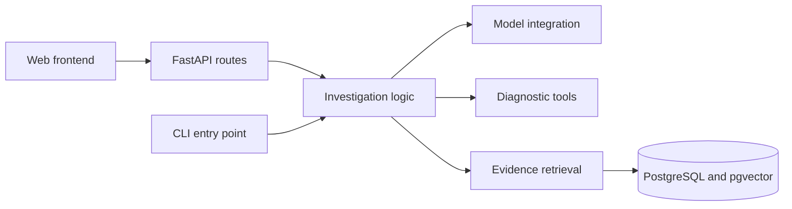

# Architecture

IncidentClue is designed as a web application with a modular Python backend. It uses operational evidence to produce a structured hypothesis, supporting references, and suggested diagnostic checks. The repository groups independently packaged applications under backend/ and frontend/.

## Current implementation

The backend implements Evidence and Incident input models. Validation tests cover accepted evidence kinds, timestamp parsing, required fields, invalid nested observations, and duplicate evidence IDs. The repository also contains package configuration and a synthetic incident example. frontend/ currently documents the web-client boundary only. Diagnosis output and the investigation pipeline are pending. There is no CLI, API, frontend application, model integration, or database connection yet.

## Incident input contract

| Field | Rule |
| --- | --- |
| incident_id | Required, nonempty string identifying the incident |
| service | Required, nonempty string identifying the affected service |
| summary | Required, nonempty description of the reported symptoms |
| evidence | Required list of validated Evidence records; may be empty |

Each Evidence record requires a nonempty id and content, a parseable timestamp, and a kind of deployment, log, or health. Evidence IDs must be unique within an incident so a citation identifies exactly one observation. Separate incidents may reuse the same evidence IDs; references therefore need the incident context.

An explicitly empty list represents a snapshot with no observations. A missing or null evidence field is rejected as malformed input. Input validity does not establish the truth of observations or the cause of an incident.

## Proposed request flow

1. Validate an incident snapshot containing logs, health observations, and deployment events.
2. Send the bounded evidence to an LLM through a provider API.
3. Validate the response structure and verify that cited evidence IDs exist in the input.
4. Return a hypothesis or an insufficient-evidence outcome, together with supporting references and suggested checks.

The initial inference provider is planned to be Groq, accessed through the OpenAI Python SDK. Provider-specific capabilities and limits must be validated during integration.

## Component boundaries

| Location | Responsibility |
| --- | --- |
| backend/src/incidentclue/ | Python package; data models and investigation logic |
| backend/tests/ | Backend tests and shared test fixtures |
| backend/pyproject.toml | Python packaging, dependencies, and test configuration |
| frontend/ | Web client with its own future dependencies and build configuration |
| data/synthetic/ | Synthetic incident snapshots for local development and demonstrations |
| docs/ | Application architecture and technical documentation |

Keep the core investigation logic independent of CLI and HTTP entry points. Add retrieval, tool execution, orchestration, and persistence when implemented rather than introducing empty modules in advance.

## Extension strategy

The following boundaries describe planned implementation, not existing features:

- Entry points translate input/output and handle interface-specific errors. They do not own investigation decisions or duplicate business logic.
- The investigation code coordinates evidence collection and diagnosis. It should not depend on frontend types, HTTP request objects, or CLI arguments.
- Define explicit input/output schemas at the backend boundary. When HTTP endpoints exist, use their API schema as the contract for the frontend, with contract validation before incompatible changes.
- Keep SDK calls and database queries in integration modules as those features arrive. Introduce interfaces when multiple implementations or concrete testing needs justify them.
- Tests live alongside their owning application. Keep backend unit checks independent of live model services; add integration checks for real provider/database behavior separately.
- Use configurable paths for shared incident data. Runtime code must not assume that its working directory is the repository root; installed applications need explicit data paths or packaged resources.
- Add frontend build files, backend container files, root orchestration, and CI jobs when their corresponding runnable components exist. Preserve independent builds instead of coupling Python and frontend package managers.

The intended development path is a CLI over the investigation engine, then a FastAPI interface over the same engine, then a web client. A queue or persistent job API can be introduced if measured investigation duration requires asynchronous execution; it is not a prerequisite for the first request.

## Evidence and execution boundaries

Logs and retrieved content are untrusted input. Valid response structure and resolvable evidence IDs do not establish that a diagnosis is correct; evidence support requires separate evaluation. Expected root-cause labels must remain separate from model-visible incident snapshots.

Initial diagnostic tools will be read-only. Any future state-changing action must require application-enforced authorization and explicit human approval.
