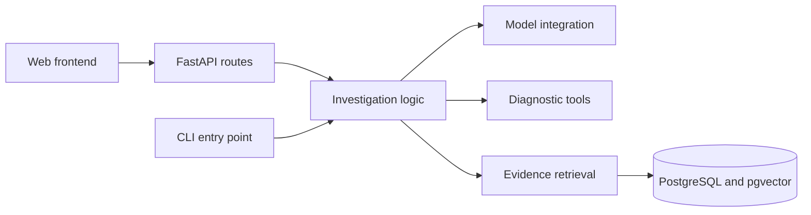

# Architecture

IncidentClue is designed as a web application with a modular Python backend. It uses operational evidence to produce a structured hypothesis, supporting references, and suggested diagnostic checks. The repository groups independently packaged applications under backend/ and frontend/.

## Current implementation

The backend implements input/output models, a citation-membership guard, Groq connectivity, single-request diagnosis, and a bounded optional health-tool investigation. The CLI exposes both flows with local run records. Offline tests exercise the installed SDK through a fake HTTP transport. Live diagnosis and one tool-assisted investigation succeeded; semantic response limitations are recorded. The HTTP API, frontend, database, and broader evaluation remain pending.

## Incident input contract

| Field | Rule |
| --- | --- |
| incident_id | Required, nonempty string identifying the incident |
| service | Required, nonempty string identifying the affected service |
| summary | Required, nonempty description of the reported symptoms |
| evidence | Required list of validated Evidence records; may be empty |

Each Evidence record requires a nonempty id and content, a parseable timestamp, and a kind of deployment, log, or health. Evidence IDs must be unique within an incident so a citation identifies exactly one observation. Separate incidents may reuse the same evidence IDs; references therefore need the incident context.

An explicitly empty list represents a snapshot with no observations. A missing or null evidence field is rejected as malformed input. Input validity does not establish the truth of observations or the cause of an incident.

## Diagnosis output contract

All five fields must be supplied, including probable_cause when its value is null. Unexpected fields are rejected.

| Field | Rule |
| --- | --- |
| status | hypothesis or insufficient_evidence |
| probable_cause | Required string or null; a hypothesis requires nonblank text, while insufficient_evidence requires null |
| evidence_ids | Required list of nonblank strings; a hypothesis requires at least one ID |
| missing_evidence | Required list of strings identifying information still needed |
| next_checks | Required list of strings describing suggested diagnostic checks |

An insufficient-evidence result may cite inconclusive observations without asserting a cause. Suggested checks are text only and do not authorize execution.

The schema checks structure and cross-field consistency. The separate validate_evidence_references(incident, diagnosis) function in backend/src/incidentclue/diagnosis.py checks whether every cited ID exists in the explicitly supplied incident. diagnose_incident performs both checks before returning a Diagnosis. Consumers that bypass that function must perform both themselves; the schema alone does not check incident-specific references.

The guard uses exact, case-sensitive ID matching and raises ValueError listing unknown IDs in deterministic order. It checks citations even when the result is insufficient_evidence, accepts an empty citation list when that status permits it, and does not change either object. Its time complexity is linear in the number of input/cited IDs, plus sorting unknown IDs for the error message.

An ID present only in a different incident fails this check. Because IDs may be reused across incidents, the caller must associate the result with the correct input snapshot. Membership alone does not prove origin, truth, or semantic support; diagnosis quality requires separate evaluation.

## Diagnosis request flow

1. Validate an incident snapshot containing logs, health observations, and deployment events.
2. Send the bounded evidence to an LLM through a provider API.
3. Validate the response structure and verify that cited evidence IDs exist in the input.
4. Return a hypothesis or an insufficient-evidence outcome, together with supporting references and suggested checks.

diagnose_incident(incident, client, model) keeps trusted instructions in a system message and serializes the incident as JSON in a separate user message. This separation is covered by offline request-format tests; it is not proof that arbitrary prompt injection will be resisted. The application enforces output/reference rules independently and has no tool-execution capability at this stage.

The serialized incident has a 12,000-byte UTF-8 budget; this is a data-size limit, not an exact token count or full HTTP request-size limit. The completion budget is 1,024 tokens. The function sets SDK retries to zero and uses the configured transport timeout for each request. It does not retry or repair malformed outputs. Refusals, truncation, missing content, unsupported tool responses, invalid Diagnosis payloads, and unknown citations raise DiagnosisError. Empty model configuration raises ConfigurationError. Provider/network failures remain SDK exceptions rather than becoming an insufficient-evidence diagnosis.

The initial inference provider is Groq, accessed through the OpenAI Python SDK. llm.py creates a client with the fixed Groq endpoint, an explicit SDK timeout, and no automatic retries. smoke.py requests one tiny strict JSON object, checks completion/refusal/content, and emits credential-free metadata. Runtime configuration comes from process environment variables or an explicitly supplied local file; application code does not assume the repository working directory to find secrets.

The default model is openai/gpt-oss-20b, listed by Groq for strict structured output. One live request verified access and the connectivity response schema; future environments must run their own check. Provider timeouts/rate limits/authentication errors are separate from output-validation failures. The timeout is an SDK transport setting, not a hard wall-clock deadline. Documentation: [Groq compatibility](https://console.groq.com/docs/openai), [Structured Outputs](https://console.groq.com/docs/structured-outputs).

## CLI and local records

The installed `incidentclue diagnose` command in cli.py owns argument parsing, explicit file/configuration loading, bounded UTF-8 input, error-to-exit-code mapping, and terminal output. It calls diagnose_incident without duplicating its request or validation logic. InputLimitError specializes DiagnosisError so oversized incident data maps to an input error. Accepted insufficient-evidence results are successful executions; provider failures remain failures.

The command prints only Diagnosis JSON to stdout and uses stderr for errors and record locations. Optional records contain UUID run identifiers, actual configuration and hashes, processing duration, and the validated result or sanitized failure. records.py writes them with exclusive creation; filenames do not derive from untrusted incident identifiers. Record-directory preparation precedes inference, but a later write failure returns exit code 3 even if a diagnosis was printed. Local JSON records are not transactional audit storage. Credentials/raw evidence/raw provider errors are omitted; diagnosis text and input identifiers may still be sensitive. Provider usage/response identifiers are null because the core function currently returns only Diagnosis.

## Read-only tool investigation

investigation.py coordinates one tool-selection request with `tool_choice=auto`, at most one Python execution, and a separate final strict-schema request. tools.py defines the allowed health function, strict argument validation, bounded snapshot loading, and the incident-service scope. The model never chooses a filesystem path or arbitrary executable. There is no live probe, MCP server, LangChain integration, or recursive agent loop in this increment.

The original incident is copied before enrichment. Successfully returned health observations become eligible evidence for final citation validation; errors never become observations. Duplicate IDs across original and fetched evidence fail explicitly. The model's assistant tool-call envelope and a matching `role=tool` result go to the final request, which offers no tools. The shared final-response helper in diagnosis.py retains completion, schema, consistency, and citation checks. Selection prose is not accepted as the final diagnosis.

Tools and strict structured output use separate requests because of the provider's documented limitation. The application allows only one requested function call, regardless of provider parallel-call settings. Invalid requests stop rather than repairing; unavailable/unauthorized lookups return controlled error results and allow a diagnosis from remaining evidence. Provider errors propagate, with no automatic retries. Limits are two requests, one tool execution, bounded arguments and snapshot observations, and the normalized incident byte limit after enrichment. The limit does not cover the entire prompt; transport timeouts are not an overall deadline.

Investigation records capture tool events (including returned observations), snapshot hash, and separate instruction hashes. Successful output does not imply all suggested actions are read-only: executable permissions are enforced by the dispatcher, while advice quality still needs review. The [live health-tool record](validation/health-tool-2026-10-28.md) demonstrates both a working request/result path and a textual restart suggestion that violated prompt guidance. The single-service check is a local application scope, not a production multi-user authorization system.

Provider references: [local tool calling](https://console.groq.com/docs/tool-use/local-tool-calling), [structured-output limitations](https://console.groq.com/docs/structured-outputs), [OpenAI function-calling protocol](https://developers.openai.com/api/docs/guides/function-calling).

## Component boundaries

| Location | Responsibility |
| --- | --- |
| backend/src/incidentclue/ | Python package; data models and investigation logic |
| backend/tests/ | Backend tests and shared test fixtures |
| backend/pyproject.toml | Python packaging, dependencies, and test configuration |
| frontend/ | Web client with its own future dependencies and build configuration |
| data/synthetic/ | Synthetic incident snapshots for local development and demonstrations |
| docs/ | Application architecture and technical documentation |

Keep the core investigation logic independent of CLI and HTTP entry points. Add retrieval, tool execution, orchestration, and persistence when implemented rather than introducing empty modules in advance.

## Extension strategy

The following boundaries describe planned implementation, not existing features:

- Entry points translate input/output and handle interface-specific errors. They do not own investigation decisions or duplicate business logic.
- The investigation code coordinates evidence collection and diagnosis. It should not depend on frontend types, HTTP request objects, or CLI arguments.
- Define explicit input/output schemas at the backend boundary. When HTTP endpoints exist, use their API schema as the contract for the frontend, with contract validation before incompatible changes.
- Keep SDK calls and database queries in integration modules as those features arrive. Introduce interfaces when multiple implementations or concrete testing needs justify them.
- Tests live alongside their owning application. Keep backend unit checks independent of live model services; add integration checks for real provider/database behavior separately.
- Use configurable paths for shared incident data. Runtime code must not assume that its working directory is the repository root; installed applications need explicit data paths or packaged resources.
- Add frontend build files, backend container files, root orchestration, and CI jobs when their corresponding runnable components exist. Preserve independent builds instead of coupling Python and frontend package managers.

The intended development path is a CLI over the investigation engine, then a FastAPI interface over the same engine, then a web client. A queue or persistent job API can be introduced if measured investigation duration requires asynchronous execution; it is not a prerequisite for the first request.

## Continuous integration and packaging

.github/workflows/ci.yml checks pushes and pull requests using a Linux/Python 3.12, Linux/Python 3.13, and Windows/Python 3.13 matrix. Dependencies and build/lint tools are pinned in the development snapshot. Ruff checks common error rules with an explicit backend configuration, independent of parent workspace configuration. Builds use the installed pinned backend without isolated dependency resolution, producing an sdist and then a wheel from that sdist. CI installs the wheel and runs dependency checks and offline tests against it. Installed CLI help is also tested from outside the checkout. backend/MANIFEST.in excludes checkout-dependent tests from the source distribution and includes dependency constraints; backend/README.md supplies package metadata documentation.

The stable CI gate depends on the entire matrix and fails when any job fails, is skipped, or is cancelled. Workflow permissions are read-only; external actions are pinned by commit. No application secrets are supplied, and live inference is not part of the routine suite. CI performs package downloads; tests simulate provider responses rather than verifying Groq availability. A passing matrix covers the named OS/Python combinations, not all platforms or factual model behavior. Required status checks depend on actual repository branch-protection capability. Docker images, publishing, deployment, and rollback are later delivery stages.

## Container boundary

backend/Dockerfile builds a backend wheel and downloads pinned runtime dependency wheels in a builder stage. A separate runtime stage installs only those wheels and runs the CLI as UID/GID 10001. The official Python base is pinned by a multi-platform manifest digest; runtime and development snapshots remain separate. The root .dockerignore allowlists backend packaging/source inputs, excluding environment files, fixtures, host caches, Git, and run output. Configuration/input files are explicitly mounted at execution time; a named output volume retains local records across disposable containers. See [container usage](containers.md).

The CI container job verifies a Linux amd64 build, runtime identity, absent development tools, dependency compatibility, CLI startup, and mounted-input/error-record behavior with networking disabled. CI gate depends on both the Python matrix and container job. A container improves runtime repeatability but does not make stochastic model responses deterministic, provide live monitoring, prove cross-architecture compatibility, or deploy the app. Docker was not available in the implementation shell; actual container verification runs on GitHub's Linux runner. Image publishing and Compose are deferred until their components and destination are defined.

## Evaluation boundary

Synthetic incident files contain only model-visible incident fields. Expected statuses and review criteria live separately in evals/pilot-cases.json, which the CLI does not load. The initial three-case pilot and actual outputs are preserved in docs/validation/pilot-2026-10-28.md. Offline validation tests establish deterministic contract/error behavior; live manual review checks whether supplied observations support claims. Neither citation membership nor matching an expected status alone establishes diagnosis correctness.

## Evidence and execution boundaries

Logs and retrieved content are untrusted input. Valid response structure and resolvable evidence IDs do not establish that a diagnosis is correct; evidence support requires separate evaluation. Expected root-cause labels must remain separate from model-visible incident snapshots.

The initial health tool is read-only. Any future state-changing action must require application-enforced authorization and explicit human approval.
