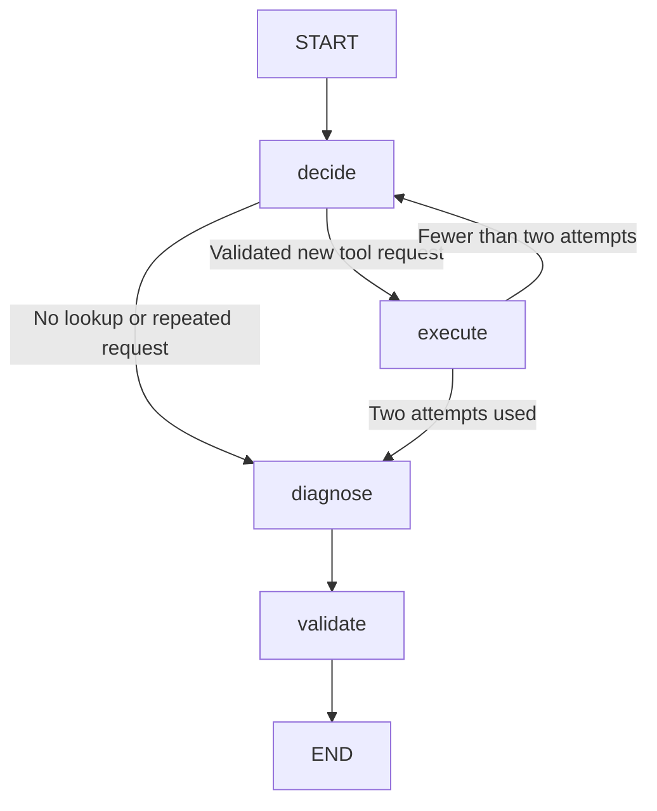

# Bounded investigation graph

`investigate` uses LangGraph StateGraph to coordinate sequential decisions and read-only tools. `diagnose` retains its single-request path. The CLI flags and output Diagnosis schema are unchanged.

Invalid requests, conflicting evidence, provider failures, and invalid final output raise errors rather than continuing down a success path. No retries or repair loop are configured.

## State and update rules

| Field | Purpose | Update rule |
| --- | --- | --- |
| incident | Original input copied for this run | Retained |
| evidence | Original and successfully returned observations | Custom reducer adds IDs, skips identical observations, rejects conflicting content under an existing ID |
| tool_history | Completed lookup attempts, including unavailable/denied results | Append reducer caps history at two entries |
| messages | Original input and bounded tool exchanges | Replace with updated conversation list |
| tool_calls_used | Executed lookup attempts | Replace with prior count plus one |
| model_requests_used | Completed selection/final requests | Replace with prior count plus one |
| pending_call | Validated request awaiting execution | Replace or clear |
| stop_reason | Why gathering ended | Replace |
| raw_diagnosis / diagnosis | Final content, then accepted Diagnosis | Replace in respective nodes |

Clients and credentials are captured by the builder, not stored in graph state. Nodes return updates without changing the caller's incident or snapshots. TypedDict describes state structure; existing Pydantic contracts still perform runtime boundary validation.

## Nodes and limits

- `decide` checks the enriched input and budgets before requesting one model choice. Only enabled tools are offered; Python validates returned names, identifiers, and arguments.
- `execute` checks the budget again, executes the allowlisted function with existing service/time/result restrictions, merges valid evidence, and increments the attempt count. Failed or denied lookups consume an attempt. Routing skips another selection once two attempts are used.
- `diagnose` requests strict JSON with no tools offered, using the same request/envelope checks as direct diagnosis.
- `validate` applies schema/business-invariant and incident-specific reference checks before accepting output.

At most two selection requests and one final request run. Selection and final completion budgets remain 512 and 1,024 tokens. SDK retries are disabled. The 20-second transport timeout per request is not an overall deadline. A recursion limit of 10 is a secondary guard; counters/routing enforce application budgets. Normal paths execute three to six nodes.

The 12,000-byte normalized incident budget applies before selection and after enrichment. Snapshot, argument, and result bounds remain in force. Two history entries/tool exchanges bound accumulation; this is not a tokenizer-based full-prompt budget or long-running memory strategy.

## Duplicate handling and records

Request fingerprints compare validated arguments and tool names, normalize log timestamps to UTC, and ignore JSON property order. An identical request is not executed again: a matching tool response reports repeated_request, and the graph routes to diagnosis using existing evidence. Reused tool-call identifiers are rejected independently. Different overlapping queries may execute, but identical observations are not duplicated in evidence. Conflicting content under one ID fails instead of silently replacing facts. Failed lookups remain history, never outage observations.

Records include LangGraph version, actual node sequence, tool events, and completed-run counts/stop reason. Entered nodes and existing tool events remain on failure; completed-run summary counts may be absent. History and state are per investigation, not global memory.

## Persistence and evaluation

No checkpointer or persistent store is configured. Every invocation starts fresh. JSON records and Docker volumes do not provide execution resumption. Durable pause/resume, storage retention, and duplicate-safe accounting across crashes are separate work; this implementation provides no exactly-once guarantee across restarts.

Tests cover two-lookup routing, budget stopping, early stopping, repeated/equivalent queries, merging/conflicts, failures, provenance, and final validation. One [live graph observation](validation/langgraph-2026-10-29.md) selected logs and then stopped after one lookup. It demonstrates that path, not general quality or reliable two-step model behavior. Python enforces executable permissions; textual advice still needs review.

The integration uses [StateGraph](https://docs.langchain.com/oss/python/langgraph/graph-api) directly with existing Groq/OpenAI SDK calls. No model wrappers, hosted tracing, or paid service configuration were added. Supporting LangChain/LangSmith packages are transitive dependencies. Refresh both runtime and development snapshots when updating dependencies, then verify package and container CI.
