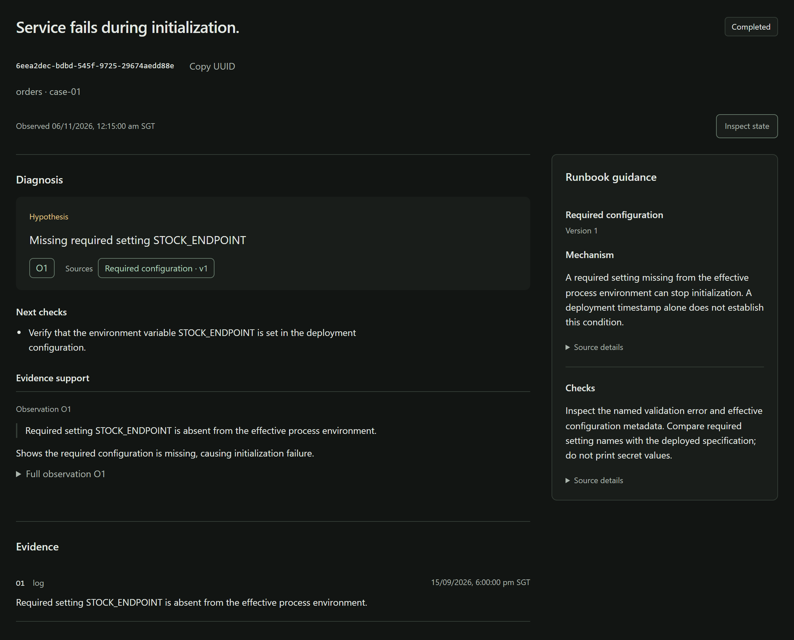
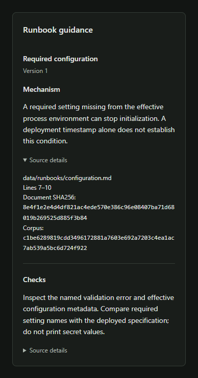

# Product screenshots

Saved `openai/gpt-oss-20b` output from a synthetic evaluation case, replayed in the
current UI. The sources come from that run's historical retrieval configuration.

## Completed investigation

Diagnosis, supporting evidence, next checks and cited runbook passages in one view.

## Runbook guidance

Cited runbook passage with its version and source location.

