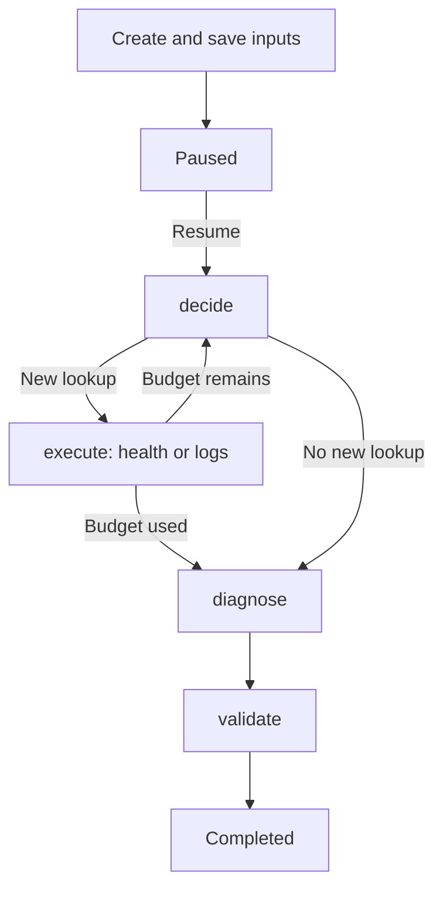
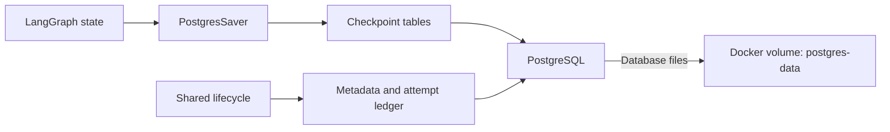

# Workflow and recovery

The browser, REST API and durable CLI share a LangGraph workflow.
Each saved investigation has a UUID used to reopen and resume it.

## Investigation flow

Browser/API creation pauses with zero attempts charged; CLI `start` can execute
immediately. Python limits each investigation to **three model requests and two
tool attempts**, with no automatic provider retries.

GPT-OSS tool selection uses low reasoning effort within the 512-token cap.
Final diagnosis keeps its existing 1,024-token cap and provider reasoning default.

Tools read recorded health and log snapshots. Evidence is deduplicated;
conflicting IDs fail. The result is a hypothesis or `insufficient_evidence`, validated against
the supplied evidence IDs. References do not prove causation, and suggested
checks are not executed.

## Where checkpoints are saved

`PostgresSaver` commits graph state at node boundaries. Application tables save
inputs, model settings, status and charged attempts. These use separate
transactions; recovery reconciles them before continuing.

Docker Compose mounts `postgres-data` to persist investigation data outside
containers. Recreating containers with the same volume preserves saved work.
Resume restores saved inputs, evidence and settings using current credentials.

## Pause and resume

- **Resume:** restore state under an exclusive execution lock.
- **Pause:** stop at a saved boundary; an in-flight node can finish. Completion
  takes precedence at the final boundary.
- **Inspect:** read saved progress without model/tool calls.
- **Completed resume:** return the saved result with zero new calls; no provider key needed.

Failed or incompatible unfinished runs remain inspectable but cannot resume.
There is no automatic state migration. Execution runs in the request/process;
closing a browser or losing a response does not cancel it.
Inspect the UUID before retrying.

## Crash recovery

Each model/tool attempt is charged before execution. Successful node output is
saved separately so it can be reused if the graph checkpoint has not caught up.

| Interruption | Behavior |
| --- | --- |
| Before reservation | Continue from saved progress |
| After output is committed | Reuse output without another call |
| After reservation, without saved output | Keep the charge and refuse replay as `recovery_required` |
| Database connection or ownership lost | Stop execution and reconcile saved state |

Budgets never reset during recovery. An uncertain call may already have happened;
inspect it and start a separate investigation rather than replaying it.
This does not guarantee exactly-once execution.

## Keeping saved work

Use the [quick start's stop command](../README.md#quick-start) to retain volumes.
`docker compose down` also keeps them; **`docker compose down -v` deletes saved data**.
A volume is not a backup.

Storage setup initializes compatible tables without resetting existing data.
Incompatible schemas are refused; API startup and health checks do not migrate them.

See the [HTTP API](http-api.md), [CLI guide](cli.md) and
[recovery tests](../backend/README.md#tests-and-package-checks) for usage and verification.
